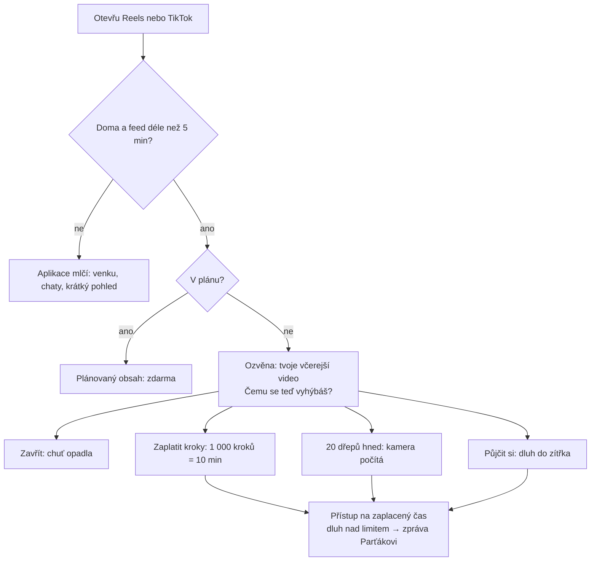

# Narsil – projektový brief

Stav k 27. 11. 2026 · živá verze: [Claude Docs](https://claude.ai/artifact/YMzpFQJgLsro2KgZUhj4Fn)

Narsil je Android aplikace, která pomáhá člověku z prokrastinace na sociálních sítích a v pasivním obsahu. Je pomocník, ne dozorce: zasahuje jen doma, v komfortním prostředí, kde prokrastinace vzniká. Venku, ve společnosti a ve zprávách je neviditelná. Hlavní mechanika se jmenuje Ozvěna: ve chvíli pokušení pustí uživateli jeho vlastní video. Název odkazuje na zlomený meč, který byl znovu ukován: relaps není konec. Brief slouží k odsouhlasení rozsahu a klíčových rozhodnutí v týmu.

## Problém a insight

Zákazy nefungují, protože každá technická zábrana jde obejít. Kdo si zablokuje Instagram, otevře ho v prohlížeči. Kdo má blokovací aplikaci, smaže ji. Stavět vyšší zeď jen učí člověka lépe přelézat.

Prokrastinace není lenost, ale útěk před nepříjemným pocitem (nuda, únava, strach, nejistota). Vyhraje řešení, které ten pocit oslabí, nebo dá člověku silnější důvod, než je on sám.

- **Pomocník, ne dozorce.** Aplikace neomezuje běžný život: rychlé video pro kamaráda venku ani zprávy se neřeší. Zasahuje jen tam, kde prokrastinace opravdu vzniká.
- **Vlastní hlas přesvědčí víc než cizí.** Na zákaz se člověk naštve, se sebou z minulosti se hádá hůř.
- **Rozhodnutí v klidu je lepší než rozhodnutí v pokušení.** Pravidla nastavuje večerní já, ne já v pokušení.
- **Kód se dá obejít, lidi ne.** Kontrolu přesouváme z aplikace na vztahy.
- **Pohyb je zároveň cena i lék.** Mění fyzický stav, který chuť scrollovat často vyvolává.

## Koncept: čtyři pilíře

Celek drží jedno pravidlo: **plánovaná spotřeba je zdarma, neplánovaná se platí pohybem.**

1. **Večerní smlouva.** Každý večer 2 minuty: pohybový cíl na zítra (kroky, minuty aktivity nebo dřepy), plánovaný obsah na zítra (např. „přednáška o Rustu, jeden díl seriálu“) a 15sekundové video, jak se dnes cítím.
2. **Ozvěna v okamžiku pokušení.** Když aplikace pozná neplánovanou spotřebu, ukáže překryvné okno s vlastním videem uživatele a otázkou „Čemu se teď vyhýbáš?“. Pak nabídne zaplatit kroky, udělat 20 dřepů hned, nebo si půjčit.
3. **Hodnota obsahu.** U videí záměr před sledováním a hodnocení 1–5 po něm. Z toho vzniká osobní mapa hodnoty: které kanály a formáty dokoukávám, ale hodnotím nízko.
4. **Parťák.** Jeden blízký člověk dostane zprávu, když se aplikace přestane hlásit (smazání, vypnutí služby), nebo když dluh přeroste limit. Nedostává žádná data ani videa.

Detekce hlídá chování, ne seznam aplikací: nekonečné scrollování a řetězení videí se pozná v jakékoli aplikaci i v prohlížeči.

## Kdy aplikace zasahuje a kdy ne

Narsil zasahuje jen tehdy, když platí obojí zároveň: člověk je v komfortní zóně a sleduje nekonečný obsah déle než 5 minut. Platí zásada: raději zásah propásnout, než člověka zbytečně otravovat.

| Situace | Chování aplikace |
| --- | --- |
| Doma, sám, dlouhé scrollování feedu, Reels nebo TikToku | Plný zásah: Ozvěna a placení pohybem |
| Doma, řetězení neplánovaných videí na YouTube | Plný zásah |
| Doma, krátký pohled do 5 minut | Nic |
| Doma, plánovaný obsah ze smlouvy | Nic |
| Venku, ve společnosti (ukážu kamarádovi video nebo Reels) | Nic, aplikace se ani neozve |
| Zprávy a chaty (Instagram Direct, Messenger, WhatsApp) | Nikdy, ani doma; nepočítá se do rozpočtu |
| Jedno video z odkazu, který přišel v chatu | Nic; zásah až když na něj navazují další |

**Jak poznáme komfortní zónu:**

1. **Domácí Wi-Fi** (hlavní signál): při nastavení uživatel označí svou síť. Je to spolehlivé a nepotřebuje průběžné sledování polohy.
2. **Vlastní zóny:** kolej, pokoj u rodičů, pracovní stůl v kanceláři. Uživatel sám určí, kde prokrastinuje.
3. **Doplňkové signály (roadmapa):** geofence domova, telefon v klidu (Activity Recognition), nabíjení, večerní hodiny.

**Jak oddělíme zprávy od feedu:** chatovací aplikace vůbec nesledujeme. Uvnitř Instagramu a TikToku Accessibility rozliší obrazovku zpráv od feedu, Reels a stránky Pro tebe. Sledujeme jen ty, kde běží nekonečný obsah.

## Gamifikace

Gamifikace má nejvyšší váhu v hodnocení aplikace (25 %). Odměňuje nejlepší rozhodnutí, ne placení: nejvíc XP dostane ten, kdo od feedu odejde sám. Nikdy netrestá: dluh ani relaps XP neberou, jen nepřidávají.

| Mechanika | Jak funguje | MVP |
| --- | --- | --- |
| XP za rozhodnutí | Zavřít 50 XP, dřepy 20, kroky 10, půjčka 0; splněná večerní smlouva +100; ohodnocené video +5 | Postavit |
| Úrovně | Každých 500 XP nová úroveň, odemyká vzhled postavy | Postavit |
| Budoucí já (postava) | Avatar v 5 stavech podle posledních 7 dní, od unaveného po v kondici | Postavit (statické ilustrace) |
| Souboj s algoritmem | Denní skóre: minuty, které sis vzal zpátky, proti minutám feedu; vyhraný den = bod | Postavit |
| Série se žolíky | Série dnů se splněnou smlouvou; žolík za 50 dřepů navíc ochrání sérii při relapsu | Postavit |
| Odznaky | Např. „Odešel jsem sám 10ד, „Týden bez dluhu“, „1 000 dřepů“ | Postavit 3–5 odznaků |
| Boss kritické hodiny | Nejrizikovější hodina dne z dat je boss; přežít ji bez feedu = +150 XP | Nasimulovat (pevně nastavená hodina) |
| Výzvy party | Společný cíl kroků a žebříček získaného času | Nasimulovat |

Čísla XP jsou výchozí návrh, vyladí se při testování.

## Tok intervence



Venku, ve zprávách a při krátkém pohledu aplikace mlčí. Doma projde plánovaný obsah bez přerušení, neplánovaný spustí Ozvěnu a uživatel si vybere: zavřít, zaplatit kroky, udělat dřepy, nebo si půjčit.

## Rozsah MVP

Poctivě stavíme jádro: večerní smlouvu, překryvné okno s Ozvěnou a placením pohybem a hodnocení YouTube. Zbytek na demu ukážeme na připravených obrazovkách nebo zmíníme v roadmapě.

| Funkce | MVP | Poznámka |
| --- | --- | --- |
| Večerní smlouva (pohybový cíl, plánovaný obsah, video) | Postavit | Jedna obrazovka a CameraX |
| Detekce komfortní zóny přes domácí Wi-Fi | Postavit | Při nastavení „tohle je můj domov“ |
| Detekce aplikace v popředí a URL v Chrome | Postavit | Instagram, TikTok, YouTube a jejich weby |
| Rozlišení zpráv a feedu v Instagramu a TikToku | Postavit | Podle obrazovky přes Accessibility; chatovací aplikace se nesledují |
| Detekce vzorce scrollování a tolerance 5 minut | Postavit | Jednoduchá heuristika; na demu zkrácený práh |
| Překryvné okno s Ozvěnou | Postavit | Video a otázka „Čemu se vyhýbáš?“ |
| Počítání dřepů kamerou | Postavit | ML Kit Pose Detection, hlavní moment dema |
| Kroky a kurz kroky → minuty | Postavit | Health Connect, záloha senzor kroků |
| Dluh | Postavit | Jen číslo přenesené do zítřka |
| XP, úrovně a odznaky | Postavit | Čistá logika v Kotlinu, snadno testovatelná |
| Postava budoucího já | Postavit | 5 statických ilustrací podle stavu |
| Souboj s algoritmem a série se žolíky | Postavit | Denní skóre na hlavní obrazovce |
| Hodnocení YouTube videí (záměr, 1–5) | Postavit | Název videa přes Accessibility |
| Párování videa s plánem přes LLM | Postavit | Jedno volání Claude API |
| Mapa hodnoty obsahu | Nasimulovat | Připravená data za 3 týdny |
| Zrcadlo (statistiky po prvních dnech) | Nasimulovat | Připravená data |
| Boss kritické hodiny | Nasimulovat | Pevně nastavená hodina |
| Výzvy party a žebříček | Nasimulovat | Připravená data |
| Parťák a hlídání výpadku | Nasimulovat | Ukázková notifikace na druhém telefonu |
| Vlastní zóny a doplňkové signály (geofence, klid telefonu, nabíjení) | Mimo | Roadmapa |
| Předpověď kritické hodiny | Mimo | Roadmapa |
| Postupné šednutí obrazovky | Mimo | Roadmapa, případně bonus |
| Netflix, hry, zprávy | Mimo | Stejný mechanismus, později |

## Harmonogram a rozdělení agentů (20 h)

Hlavní cíl: v 8. hodině funkční průchod TikTok → Ozvěna → dřepy na telefonu. Od té chvíle máme vždy co ukázat a jen přidáváme. Společná pravidla jsou v záložce Plány agentů.

| Kdo | Agent | Role agenta | Lidská role navíc | Vlastní balíčky a soubory | Plán |
| --- | --- | --- | --- | --- | --- |
| Marek | Claude Pro č. 1 | Architekt, jádro, integrace | Tech lead, slučování PR do `main`, správce demo telefonu Nothing | `core/`, `detection/`, `overlay/`, `app/` | Marek · Claude 1: jádro |
| Šimon | Claude Pro č. 2 | Pohyb, gamifikace, smlouva, LLM | Fyzický tester dřepů a kroků, testy na Redmi | `movement/`, `gamification/`, `contract/`, `llm/` | Šimon · Claude 2: pohyb a gamifikace |
| Jan | Gemini Antigravity Pro | Design systém a obrazovky | Design slidů, aby ladily s aplikací | `ui/` | Jan · Antigravity: design a UI |
| Štěpán | Gemini zdarma | Pitch, obhajoba, připravená data, grafika | Hlavní prezentující, časomíra a synchronizace každé 2 h, tester na obou telefonech | `pitch/`, `mockdata/`, `assets/` | Štěpán · Gemini: pitch a podklady |

Štěpán má nejlehcího agenta, proto navíc hlídá čas, brány a seznam škrtů a průběžně testuje. Marek odpovídá při obhajobě na technické otázky. Každý člověk řídí svého agenta jako orchestrátora, který pouští několik paralelních proudů (viz záložka Plány agentů).

**Co škrtat při skluzu, v tomto pořadí:**

1. Parťák: jen statický obrázek notifikace.
2. Mapa hodnoty: statický obrázek místo obrazovky.
3. Párování přes LLM: klíčová slova.
4. Health Connect: jen senzor kroků.
5. Heuristika scrollování: jen čas strávený ve feedu.
6. Boss a výzvy party: vypustit.

**Nikdy neškrtat:** detekci domácí Wi-Fi, Ozvěnu s videem, dřepy s kamerou, XP za „Zavřít“ a souboj s algoritmem. To je jádro dema i gamifikace.

| Fáze | Hodiny | Brána na konci |
| --- | --- | --- |
| Kostra | 0–1,5 h | G1 Rozhraní zamčená: build projde s fake moduly |
| Stavba modulů | 1,5–8 h | **G2 První průchod: TikTok → Ozvěna → dřepy na telefonu** |
| Integrace a gamifikace | 8–14 h | G3 Feature freeze: nic nového, jen opravy |
| Dotahování dema | 14–18 h | G4 Generálka: demo 3× bez chyby |
| Rezerva | 18–20 h | – |

Brána je kontrola, kterou celý tým projde společně. Kdo ji nesplní, škrtá podle seznamu výše, nikdo kvůli ní nepracuje déle.

## Rozhodnutí k odsouhlasení

Každé rozhodnutí má náš návrh a realistickou alternativu. Po diskuzi s týmem přepněte stav na Schváleno nebo Zamítnuto.

| # | Rozhodnutí | Návrh | Alternativa | Stav |
| --- | --- | --- | --- | --- |
| 1 | Platforma | Android, nativně v Kotlinu a Jetpack Compose | Flutter nebo React Native (stejně potřebují nativní služby); PWA nepozná jiné aplikace | Návrh |
| 2 | Filozofie | Pomocník: nic tvrdě neblokovat, pokračovat jde vždy | Tvrdý blok po vyčerpání rozpočtu | Návrh |
| 3 | Kdy zasahovat | Jen v komfortní zóně a jen u nekonečného obsahu | Všude, kde se aplikace otevře | Návrh |
| 4 | Jak poznat komfortní zónu | Domácí Wi-Fi, později vlastní zóny | GPS geofence (víc oprávnění, víc baterie) | Návrh |
| 5 | Zprávy a chaty | Nikdy nesledovat ani nepočítat | Počítat celý Instagram a TikTok | Návrh |
| 6 | Tolerance krátkého použití | První 5 minut feedu bez zásahu | Zásah hned po otevření | Návrh |
| 7 | Co detekujeme | Vzorec chování (scrollování, řetězení videí) a k tomu seznam aplikací a URL | Jen seznam aplikací | Návrh |
| 8 | Pohyb jako měna | Kurz 1 000 kroků = 10 min neplánovaného obsahu; 20 dřepů = 10 min hned | Jednorázové odemčení po splnění denního cíle | Návrh |
| 9 | Plánovaný obsah | Zdarma; zadává se textem ve smlouvě, LLM ho páruje s názvem videa | I plánovaný obsah se platí | Návrh |
| 10 | Dluh | Povolený, přenáší se do zítřejšího cíle, nad limit ho vidí Parťák | Bez dluhu, tvrdá hranice | Návrh |
| 11 | Podvádění (třesení telefonem) | Neřešíme, smlouvu píše člověk sám se sebou | Kontrola přes tep a tréninkové záznamy | Návrh |
| 12 | Uložení videí | Jen lokálně v telefonu | Cloud (záloha, návrat po smazání) | Návrh |
| 13 | Parťák v MVP | Jen ukázková notifikace | Skutečný backend s hlídáním výpadku | Návrh |
| 14 | Long content v MVP | Jen YouTube (aplikace i web) | I Netflix, hry, zprávy | Návrh |
| 15 | LLM | Claude API na párování obsahu s plánem | Bez LLM, jen klíčová slova | Návrh |
| 16 | Distribuce | APK mimo Google Play | Google Play (přísné schvalování Accessibility) | Návrh |

## Technická architektura

Vše běží v telefonu, výjimkou je jen volání LLM. Backend potřebujeme až pro skutečného Parťáka.

| Vrstva | Technologie | Účel |
| --- | --- | --- |
| UI | Kotlin, Jetpack Compose | Smlouva, překryvné okno, statistiky |
| Kontext | WifiManager (název domácí sítě; od Androidu 10 vyžaduje oprávnění k poloze) | Pozná komfortní zónu |
| Detekce | AccessibilityService (`TYPE_WINDOW_STATE_CHANGED`, `TYPE_VIEW_SCROLLED`, adresní řádek Chrome) | Aplikace v popředí, obrazovka feedu vs. zpráv, URL, vzorec scrollování, název videa |
| Překryvné okno | `SYSTEM_ALERT_WINDOW` | Ozvěna přes cílovou aplikaci |
| Video | CameraX | Večerní nahrávky |
| Dřepy | ML Kit Pose Detection | Počítání opakování přímo v telefonu |
| Kroky | Health Connect, záloha `TYPE_STEP_COUNTER` | Plnění cíle a kurz |
| Data | Room | Smlouvy, události, hodnocení, dluh |
| LLM | Claude API | Párování názvu videa s plánem, texty Zrcadla |
| Backend (roadmapa) | Jednoduchý server s hlídáním výpadku | Notifikace Parťákovi |

## Telefony

Nothing Phone 3a je demo telefon, Redmi Note 11 telefon Parťáka a záloha. Oba se používají od první hodiny, ne až před demem.

| Telefon | Role | Na co si dát pozor |
| --- | --- | --- |
| Nothing Phone 3a | Demo telefon (Marek) | Novější Android: Health Connect je součástí systému. U APK povolit omezená nastavení, jinak nejde zapnout Accessibility. Vypnout optimalizaci baterie pro aplikaci a automatické aktualizace Instagramu a TikToku. |
| Redmi Note 11 | Telefon Parťáka na demu, záložní demo telefon, test na starším Androidu | MIUI zabíjí služby na pozadí: povolit automatické spouštění, vypínat spořič baterie pro aplikaci a povolit zobrazování vyskakovacích oken při běhu na pozadí (oprávnění jen pro MIUI, bez něj se překryvné okno neukáže). Health Connect pravděpodobně doinstalovat z Google Play, jinak záloha senzor kroků. Slabší výkon: ověřit rychlost počítání dřepů. |

## Demo scénář (2 minuty)

1. **Problém (15 s):** „Každá antiprokrastinační aplikace prohrává stejnou válku: zeď proti člověku. A otravuje i tam, kde nemá.“
2. **Večerní smlouva (20 s):** cíl 6 000 kroků, plán „přednáška o Rustu“, krátké video.
3. **Venku (15 s):** bez domácí Wi-Fi ukážu kamarádovi Reels a odpovím na zprávu v Instagramu. Aplikace mlčí.
4. **Doma (20 s):** telefon se připojí k domácí Wi-Fi, po chvíli scrollování naskočí včerejší video a otázka „Čemu se teď vyhýbáš?“. Práh je pro demo zkrácený.
5. **Dřepy naživo (30 s):** člen týmu udělá před porotou 20 dřepů, kamera je počítá, feed se odemkne.
6. **Long content (10 s):** přednáška o Rustu projde zdarma, neplánované video stojí kroky. Ukážeme mapu hodnoty.
7. **Pointa (10 s):** smazání aplikace → notifikace na telefonu Parťáka. „Venku vás necháme žít. Doma vám připomeneme, kým chcete být.“

## Rizika

| Riziko | Dopad | Co s tím |
| --- | --- | --- |
| Překryvné okno nebo Accessibility se na demo telefonu chová jinak | Demo nefunguje | Testovat na konkrétním demo telefonu od začátku, mít nahrané video jako zálohu |
| Pose Detection špatně počítá dřepy v sále | Pointa dema selže | Vyzkoušet osvětlení a úhel kamery, nastavit tolerantní práh |
| Domácí Wi-Fi nesedí (doma na mobilních datech, jiná síť) | Zásah chybí | Vlastní zóny a ruční přepínač „jsem doma“ |
| Aktualizace Instagramu rozbije rozlišení zpráv a feedu | Zásah v chatu | Udržovaný seznam obrazovek; v nejistotě nezasahovat |
| Detekce scrollování dává falešné poplachy | Otravné přerušování | Tolerance 5 minut, raději zásah propásnout |
| Pohyb začne působit jako trest | Uživatel aplikaci smaže | Den volna, horní strop, volba typu aktivity |
| Rozsah se rozroste | Nestihneme jádro | Držet tabulku Rozsah MVP, nové nápady jen do roadmapy |
| Soukromí (videa, čtení obrazovky, Wi-Fi) | Nedůvěra poroty | Vše lokálně, do LLM jde jen název videa a plán, zprávy se nikdy nečtou |

## Otevřené otázky pro tým

- [ ] Kde další kromě domova prokrastinujeme (kolej, kancelář, knihovna) a patří to do MVP?
- [ ] Dřepy, nebo jiný mikropohyb, který se v sále lépe předvádí (např. výskoky)?
- [ ] Parťák na Redmi jako skutečná notifikace, nebo stačí ukázková obrazovka?

---

# Plány agentů (záložky)

## Plány agentů

Každý člověk řídí jednoho hlavního agenta jako orchestrátora. Orchestrátor sám skoro nepíše kód: rozdělí fázi na nezávislé proudy, každý proud pustí jako samostatného subagenta ve vlastním worktree, kontroluje výsledky a otevírá PR. Pravidla repozitáře jsou v `AGENTS.md`. Brief exportujte do Markdownu jako `docs/BRIEF.md` včetně těchto záložek.

### Obsazení

| Člověk | Hlavní agent | Proudů najednou | Jak pouští proudy | Řada úkolů |
| --- | --- | --- | --- | --- |
| Marek | Claude Pro č. 1 | až 3 | Subagenti Claude Code, každý ve worktree svého úkolu | 1xx |
| Šimon | Claude Pro č. 2 | až 3 | Subagenti Claude Code; dřepy v samostatné relaci | 2xx |
| Jan | Gemini Antigravity Pro | 3–4 | Paralelní agenti v Antigravity, každý ve worktree svého úkolu | 3xx |
| Štěpán | Gemini zdarma | 3–4 | Samostatné chaty, jeden na proud; výstupy commituje sám | 4xx |

### Jak orchestrátor pracuje

1. Na začátku fáze vezme úkoly ze své záložky a seskupí je do proudů podle tabulky fáze.
2. Před spuštěním ověří, že se Soubory proudů nepřekrývají.
3. Pro každý proud: `scripts/claim-task.sh tasks/NNN-*.md <jméno> <agent>` (zamkne úkol na `main`), pak `scripts/start-task.sh <větev>` (vytvoří worktree).
4. Subagentovi předá zadání podle šablony níže a cestu k worktree. Nic dalšího nepotřebuje.
5. Když proud skončí: zkontroluje diff a build, ve worktree spustí `scripts/finish-task.sh`, otevře PR, v tasku nastaví `status: review` a pustí další úkol.
6. Sám řeší jen integraci a rozhodnutí, rutinní kód nechává proudům.
7. Limity: na Claude Pro nejvýš 3 proudy najednou, paralelní agenti spotřebují limit rychleji. Když se blíží limit, pokračuje jedním proudem a rutinu dává úspornějšímu modelu.

### Zadání pro subagenta (šablona)

```text
Úkol: tasks/NNN-nazev.md (přečti ho celý).
Pracuješ jen ve worktree <cesta>, větev <větev>. Řiď se AGENTS.md.
Smíš měnit jen: <Soubory z tasku>. Nic jiného.
Používej rozhraní z cz.narsil.core (popis v docs/contracts.md). Chybí-li něco,
použij fake z cz.narsil.core.fake a zapiš to do Poznámek v tasku.
Hotovo, když: <kritéria z tasku>.
Ověř: ./gradlew assembleDebug testDebugUnitTest
Commituj malé kroky s prefixem [claude] nebo [gemini]. PR neotevírej.
Na konci vrať: co jsi změnil, jak to otestovat, co zůstalo otevřené.
```

### Synchronizace lidí

- Každé 2 hodiny 10 minut, časomíru drží Štěpán: Marek sloučí PR, instalace na Nothing, projdou se Poznámky v tascích, upraví se proudy.
- Mezi synchronizacemi lidé sami neprogramují. Testují na telefonech, kontrolují PR a odpovídají na Poznámky, aby proudy nestály.

### Sdílená rozhraní (zamyká Marek v 1,5 h)

| Rozhraní | Co dělá | Implementuje |
| --- | --- | --- |
| `ContextRepository` | Stav HOME / AWAY / UNKNOWN jako `Flow` | Marek (112) |
| `ConsumptionEvent` | Aplikace, povrch (FEED, REELS, SHORTS, MESSAGES, VIDEO), délka, název videa | Marek (111) |
| `InterventionTrigger` | Událost „teď zasáhnout“ z detekce | Marek (111) |
| `InterventionOutcome` | CLOSED, PAID\_STEPS, SQUATS, BORROWED, PLANNED\_FREE | Marek (114) |
| `MovementRepository` | Kroky dnes, zůstatek minut, `pay()`, `borrow()`, dluh | Šimon (211) |
| `SquatCounter` | Počítání dřepů jako `Flow<Int>` a náhled kamery | Šimon (210) |
| `GamificationEngine` | `onOutcome()` → XP; stav: XP, úroveň, série, žolíky, postava, denní skóre | Šimon (220) |
| `ContractRepository` | Dnešní smlouva: cíl kroků, plánovaný obsah, video | Šimon (212) |
| `ContentMatcher` | `isPlanned(název, plán)` | Šimon (221) |
| `EchoVideoRepository` | Výběr videa pro Ozvěnu | Šimon (212) |
| `mockdata/schema.md` | JSON pro Zrcadlo, mapu hodnoty, žebříček | Marek navrhne (104), Štěpán naplní (430) |

UI čte stav jen přes ViewModely se `StateFlow<UiState>`, takže Jan pracuje s fake daty od první minuty.

### Sekce Projekt pro AGENTS.md

Marek v úkolu 104 nahradí TODO v `AGENTS.md` tímto textem:

```markdown
## Projekt

Narsil: Android aplikace proti prokrastinaci na sociálních sítích (hackathon, 20 h).
Zadání a plán: docs/BRIEF.md. Priorita: funkční demo, ne dokonalý kód.

- Stack: Kotlin, Jetpack Compose, jeden modul app, minSdk 29, Room, CameraX,
  ML Kit Pose Detection, Health Connect, Media3, OkHttp.
- Build: ./gradlew assembleDebug · Testy: ./gradlew testDebugUnitTest
- Instalace: ./gradlew installDebug (demo Nothing Phone 3a, záloha Redmi Note 11)
- Balíčky a vlastníci (Soubory v tasku jen z vlastních balíčků):
  - cz.narsil.core, detection, overlay, app: Marek / Claude (úkoly 1xx)
  - cz.narsil.movement, gamification, contract, llm: Šimon / Claude (2xx)
  - cz.narsil.ui a res/: Jan / Antigravity (3xx); každá obrazovka ve vlastní
    složce ui/screens/<obrazovka>/, sdílené komponenty jen v úkolu 302
  - mockdata/, pitch/, assets/: Štěpán / Gemini (4xx)
- Rozhraní v cz.narsil.core a docs/contracts.md mění jen Marek.
- Blokuje tě cizí modul: použij fake z cz.narsil.core.fake a pokračuj.
- Nové závislosti nepřidávej, vše je v gradle/libs.versions.toml.
- API klíč Claude jen v local.properties (není v gitu).
- Texty v UI česky. Hlavní mechanika se v UI jmenuje Ozvěna.
```

## Claude Pro č. 1: architekt a jádro

Obsluhuje Marek. Je to kritická cesta: bez kostry v 1,5 h a bez detekce a překryvného okna v 8 h není co ukazovat. Vlastní `core`, `detection`, `overlay` a `app` a jako jediný mění sdílená rozhraní. Orchestrátor sám píše jen kostru (101) a integraci (115, 124), zbytek běží ve 3 paralelních proudech.

### Úvodní prompt orchestrátora

```text
Jsi orchestrátor části projektu Narsil (hackathon, 20 h): jádro, detekce,
překryvné okno a integrace. Řiď se AGENTS.md, zadání je v docs/BRIEF.md,
tvůj plán je níže. Sám piš jen kostru (101) a integraci (115, 124).
Ostatní úkoly pouštěj jako paralelní subagenty, nejvýš 3 najednou. Pro každý:
claim-task.sh, start-task.sh, pak subagent se zadáním podle šablony v záložce
Plány agentů a s cestou k jeho worktree. Před spuštěním ověř, že se Soubory
proudů nepřekrývají. Po dokončení zkontroluj diff a build, finish-task.sh,
PR a další úkol. Drobnosti rozhoduj sám, zapisuj do docs/decisions.md.
Ptej se mě jen tehdy, když stojí všechny proudy. Začni úkolem 101.

[sem vložit tuto záložku]
```

### Fáze 0: kostra (0–1,5 h, brána G1)

101 dělá orchestrátor sám hned na `main` (výjimka, repo ještě nemá kód), pak pustí 102–104 paralelně.

| # | Úkol | Proud | Soubory | Hotovo, když |
| --- | --- | --- | --- | --- |
| 101 | Kostra: Gradle, jeden modul `app`, balíčky `cz.narsil.*`, minSdk 29, `libs.versions.toml` se **všemi** závislostmi | orchestrátor (30 min) | kořen, `app/build.gradle.kts`, `gradle/` | `./gradlew assembleDebug` projde, prázdná aplikace běží na Nothing |
| 102 | Rozhraní a modely v `core`, fake ke každému, popis v `docs/contracts.md` | A | `core/`, `docs/contracts.md` | Všechna rozhraní z tabulky v Plánech agentů existují a mají fake |
| 103 | `ServiceLocator` s přepínačem fake/skutečné, navigace s prázdnými obrazovkami | B | `app/` | Aplikace naviguje mezi prázdnými obrazovkami |
| 104 | Všechny úkoly 1xx–4xx v `tasks/` podle záložek agentů, sekce Projekt v `AGENTS.md`, `docs/BRIEF.md`, `mockdata/schema.md` | C | `tasks/`, `AGENTS.md`, `docs/`, `mockdata/schema.md` | Každý úkol má cíl, Soubory a kritéria hotovo |

Po sloučení 102–104: **G1**. Šimon, Jan a Štěpán mohou brát úkoly.

### Fáze 1: detekce a překryvné okno (1,5–8 h, brána G2)

| # | Úkol | Proud | Soubory | Hotovo, když |
| --- | --- | --- | --- | --- |
| 110 | `AccessibilityService`: aplikace v popředí, URL v Chrome, ladicí výpis stromu oken | A | `detection/accessibility/` | V logu je vidět aktivní aplikace, URL a ID prvků obrazovky |
| 111 | Klasifikace povrchů (feed, Reels, Shorts, zprávy, video) a heuristika scrollování s tolerancí 5 min (demo 20 s); v nejistotě zprávy | A, po 110 | `detection/accessibility/` | Zprávy v Instagramu nikdy nespustí zásah, feed ano |
| 112 | `ContextRepository` přes Wi-Fi, oprávnění k poloze, ruční přepínač „jsem doma“ | B | `detection/context/` | Stav se změní po připojení k domácí síti na obou telefonech |
| 113 | Překryvné okno: `WindowManager`, Compose obsah s vlastním lifecycle ownerem, video přes ExoPlayer | C | `overlay/` | Okno se ukáže přes TikTok a přehraje video |
| 114 | Volby v okně → `InterventionOutcome`, časovač odemknutí (v zaplaceném čase se nezasahuje) | C, po 113 | `overlay/` | Každá volba okno zavře nebo odemkne na správnou dobu |
| 115 | Integrace: detekce + kontext + okno + `SquatCounter` od Šimona | orchestrátor (od 7 h) | `app/` | **G2:** na Nothing doma: TikTok, Ozvěna, 20 dřepů, odemknuto |

Marek mezitím na telefonu ověřuje 110 (ID prvků) a 112 (Wi-Fi) hned, jak jsou hotové.

### Fáze 2: integrace (8–14 h, brána G3)

| # | Úkol | Proud | Soubory | Hotovo, když |
| --- | --- | --- | --- | --- |
| 120 | YouTube: název videa, řetězení neplánovaných videí, volání `ContentMatcher` | A | `detection/youtube/` | Plánované video projde, třetí neplánované spustí zásah |
| 121 | Room: události spotřeby a denní souhrny pro souboj s algoritmem | B | `core/data/` | Denní minuty feedu a získané minuty jdou přečíst |
| 122 | Logika onboardingu oprávnění včetně kroků pro MIUI | C | `app/onboarding/` | Na Redmi i Nothing jde vše zapnout podle průvodce |
| 123 | Demo panel: vynutit HOME/AWAY, krátký práh, reset dne, připravená data, napojení ladících funkcí Šimona (222) | C, po 122 | `app/demo/` | Celý scénář dema jde připravit za 30 s |
| 124 | Vyměnit fake za skutečné moduly, napojit obrazovky od Jana | orchestrátor | `app/` | **G3:** všechny funkce Postavit běží spolu |

### Fáze 3: dotahování (14–18 h, brána G4)

| # | Úkol | Proud | Soubory | Hotovo, když |
| --- | --- | --- | --- | --- |
| 130 | Opravy chyb z testů na telefonech, jeden subagent na chybu | A–C | podle chyby | Scénář dema projde 3× za sebou |
| 131 | Podepsané release APK na obou telefonech | orchestrátor | `app/build.gradle.kts` | APK nainstalované, data připravená |

Záložní video dema nahrávají lidé společně. **G4.**

### Na co si dát pozor

- Android 13 a novější u APK zablokuje zapnutí Accessibility, dokud v informacích o aplikaci nepovolíte omezená nastavení. Ověřit v 110.
- ID prvků v Instagramu a TikToku se mění s aktualizacemi. Na obou telefonech vypnout automatické aktualizace těchto aplikací.
- Redmi s MIUI: bez oprávnění k vyskakovacím oknům na pozadí a bez automatického spouštění se překryvné okno neukáže.

## Claude Pro č. 2: pohyb a gamifikace

Obsluhuje Šimon. Nese gamifikaci (25 % hodnocení aplikace) a dřepy, hlavní moment dema. Vlastní `movement`, `gamification`, `contract` a `llm`. Většina logiky je čistý Kotlin, takže může začít hned, ještě před kostrou. Dřepy mají vlastní relaci, protože vyžadují nejvíc ladění a Šimon je testuje na sobě.

### Úvodní prompt orchestrátora

```text
Jsi orchestrátor části projektu Narsil (hackathon, 20 h): pohyb (kroky, dřepy
přes kameru), měna a dluh, gamifikace, večerní smlouva a párování obsahu
s plánem přes Claude API. Řiď se AGENTS.md, zadání je v docs/BRIEF.md,
tvůj plán je níže. Úkoly řady 2xx pouštěj jako paralelní subagenty, nejvýš
3 najednou; úkol 210 (dřepy) běží v samostatné relaci, kterou řídí člověk.
Pro každý úkol: claim-task.sh, start-task.sh, subagent se zadáním podle
šablony v záložce Plány agentů. Měň jen balíčky movement, gamification,
contract a llm. Rozhraní v core neměň; potřebuješ-li změnu, zapiš ji do
Poznámek v tasku a pokračuj jiným úkolem. Drobnosti rozhoduj sám, zapisuj do
docs/decisions.md. Než bude kostra v main (asi 1,5 h), pracuj na Fázi 0
mimo repozitář. Začni úkolem 201.

[sem vložit tuto záložku]
```

### Fáze 0: specifikace a čistá logika (0–1,5 h)

Kostra ještě neexistuje. 201 dělá orchestrátor sám (15 min), pak 202 a 203 paralelně ve složce mimo repozitář. Po G1 je orchestrátor přesune do balíčků jako první PR.

| # | Úkol | Proud | Soubory | Hotovo, když |
| --- | --- | --- | --- | --- |
| 201 | `docs/GAMIFICATION.md`: přesná pravidla podle sekce Gamifikace v briefu | orchestrátor | `docs/GAMIFICATION.md` | Každá mechanika má čísla a podmínky |
| 202 | `GamificationEngine` v čistém Kotlinu, unit testy | A | `gamification/` | Testy pokrývají XP, úrovně, série a žolíky |
| 203 | Měna: kurz kroků a dřepů na minuty, dluh, přenos do zítřka, unit testy | B | `movement/currency/` | Testy pokrývají placení, půjčku a přenos dluhu |

### Fáze 1: dřepy, kroky, smlouva (1,5–8 h)

| # | Úkol | Proud | Soubory | Hotovo, když |
| --- | --- | --- | --- | --- |
| 210 | **`SquatCounter`** (priorita, Marek ho napojuje v 7 h): CameraX a ML Kit Pose; úhel kyčel–koleno–kotník, dole pod 100°, nahoře nad 160°, tlumení zákmitů | A, samostatná relace | `movement/squat/` | Na Nothing počítá správně 9 z 10 pokusů, na Redmi stíhá v reálném čase |
| 211 | `MovementRepository`: kroky z Health Connect, záloha senzor kroků, zůstatek, `pay()`, `borrow()` | B | `movement/steps/`, `movement/` | Kroky z telefonu se promítnou do zůstatku minut |
| 212 | `ContractRepository` v Room, nahrávání večerního videa přes CameraX, `EchoVideoRepository` | C | `contract/` | Smlouva se uloží a druhý den se její video přehraje |

Šimon mezitím dělá dřepy před kamerou a ladí prahy s relací 210.

### Fáze 2: gamifikace a LLM (8–14 h)

| # | Úkol | Proud | Soubory | Hotovo, když |
| --- | --- | --- | --- | --- |
| 220 | Gamifikace napojená na výsledky: XP, úrovně, série se žolíky, odznaky, stav postavy, denní skóre souboje, boss v pevné hodině | A | `gamification/` | Každá volba v Ozvěně změní XP a denní skóre |
| 221 | `ContentMatcher`: Claude API vrátí JSON `{planned, reason}`, timeout 3 s, pak záloha přes klíčová slova | B | `llm/` | „Přednáška o Rustu“ v plánu spáruje s podobným názvem videa; bez sítě funguje záloha |
| 222 | Ladící funkce pro demo panel: +1 000 kroků, +500 XP, přepnutí stavu postavy (tlačítka napojí Marek v 123) | C | `movement/debug/`, `gamification/debug/` | Funkce jsou vystavené a popsané v `docs/contracts.md` přes Poznámky |

### Fáze 3: ladění (14–18 h)

| # | Úkol | Proud | Soubory | Hotovo, když |
| --- | --- | --- | --- | --- |
| 230 | Vyladit čísla XP a kurz, aby demo za 2 minuty ukázalo novou úroveň | A | `gamification/` | Scénář dema končí animací nové úrovně |
| 231 | Stabilita dřepů v sále (světlo, vzdálenost) na obou telefonech | samostatná relace | `movement/squat/` | 3 různí lidé po 20 dřepů bez chyby |

Zbylé proudy pomáhají Markovi s opravami (130).

## Gemini Antigravity Pro: design a UI

Obsluhuje Jan. Dělá všechno, co porota uvidí: design se počítá dvakrát (20 % aplikace a 20 % prezentace). Vlastní balíček `ui` a grafiku v `res/`. Každá obrazovka má vlastní složku `ui/screens/<obrazovka>/`, takže až 4 paralelní agenti v Antigravity se nikdy nepotřou. Pracuje přes Compose náhledy a fake stavy, na ostatní nečeká.

### Úvodní prompt hlavního agenta

```text
Jsi hlavní agent pro UI projektu Narsil (hackathon, 20 h). Řiď se AGENTS.md
(úkoly, větve, worktree, PR, commity s prefixem [gemini]). Zadání je
v docs/BRIEF.md, tvůj plán je níže. Sám děláš design systém (301) a
sjednocení vzhledu (330). Obrazovky rozděluj paralelním agentům, každému jednu
obrazovku ve vlastní složce ui/screens/<obrazovka>/ a vlastním worktree.
Sdílené komponenty mění jen úkol 302; obrazovka, která potřebuje novou
komponentu, si ji založí ve své složce. Data jen přes ViewModely se
StateFlow<UiState>, dokud nejsou skutečná, fake stavy. Každá obrazovka má
@Preview ve světlém i tmavém režimu. Tón: klidný, osobní, povzbuzující,
nikdy trestající. Texty česky. Drobnosti rozhoduj sám, zapisuj do
docs/decisions.md. Začni úkolem 301.

[sem vložit tuto záložku]
```

### Fáze 0: design systém (0–1,5 h)

301 dělá hlavní agent sám, ostatní na něm staví. Do G1 pracuje v samostatných souborech jen s náhledy a po G1 je přesune do repozitáře.

| # | Úkol | Proud | Soubory | Hotovo, když |
| --- | --- | --- | --- | --- |
| 301 | Barvy (světlý a tmavý režim), typografie, tvary | hlavní agent (40 min) | `ui/theme/` | Téma se používá v náhledech |
| 302 | Komponenty: lišta XP, odznak úrovně, karta postavy, karta souboje s algoritmem, série se žolíky, velké karty voleb | A, po 301 | `ui/components/` | Každá komponenta má náhled |
| 303 | Ikona aplikace a vizuální styl ilustrací jako zadání pro Štěpána | B, po 301 | `res/mipmap*/`, `docs/ilustrace.md` | Štěpán má styl a může generovat |

### Fáze 1: obrazovky pro první průchod (1,5–8 h)

Všechny čtyři běží paralelně. 310 a 311 potřebuje brána G2, mají přednost.

| # | Úkol | Proud | Soubory | Hotovo, když |
| --- | --- | --- | --- | --- |
| 310 | **Překryvné okno Ozvěny:** plocha pro video, otázka „Čemu se teď vyhýbáš?“ (nuda, únava, úkol, samota), 4 karty voleb; Zavřít je vizuálně nejatraktivnější | A | `ui/screens/echo/` | Hotovo do 6 h, Marek ho může vložit do okna |
| 311 | **Obrazovka dřepů:** náhled kamery, velké počítadlo, zpětná vazba po každém dřepu | B | `ui/screens/squat/` | Hotovo do 6 h |
| 312 | **Hlavní obrazovka:** postava, XP a úroveň, souboj s algoritmem, série, stav smlouvy, zůstatek kroků | C | `ui/screens/home/` | Náhled s fake daty vypadá hotově |
| 313 | **Večerní smlouva:** 3 kroky (pohybový cíl, plánovaný obsah, video) | D | `ui/screens/contract/` | Průchod všemi kroky v náhledu |

### Fáze 2: zbytek obrazovek (8–14 h)

| # | Úkol | Proud | Soubory | Hotovo, když |
| --- | --- | --- | --- | --- |
| 320 | Onboarding: oprávnění a nastavení domácí Wi-Fi, každé oprávnění jednou větou, kroky pro MIUI | A | `ui/screens/onboarding/` | Logiku napojí Marek (122) |
| 321 | Animace odměny a nové úrovně, hodnocení videa 1–5 jako spodní panel | B | `ui/screens/reward/`, `ui/screens/rating/` | Animace běží plynule na Redmi |
| 322 | Zrcadlo a mapa hodnoty nad připravenými daty | C | `ui/screens/mirror/` | Obrazovky čtou data od Štěpána (430) |
| 323 | Odznaky a žebříček party, ilustrace postavy v 5 stavech od Štěpána | D | `ui/screens/badges/`, `res/drawable/` | Postava mění vzhled podle stavu |

### Fáze 3: vyladění (14–18 h)

| # | Úkol | Proud | Soubory | Hotovo, když |
| --- | --- | --- | --- | --- |
| 330 | Sjednotit odsazení, barvy a texty na všech obrazovkách, přesunout lokální komponenty do `ui/components/` | hlavní agent | `ui/` | Jan projde aplikaci na Nothing a nic nevyčnívá |
| 331 | Snímky obrazovek pro slidy, slidy ve stejném stylu jako aplikace | Jan s pomocí agenta | `pitch/` | Štěpán má všechny snímky |

### Na co si dát pozor

- Antigravity neumí spustit aplikaci přímo na telefonu. Ověřuj v náhledech a emulátoru, na telefonu to zkontroluje Jan při synchronizaci.
- Video v překryvném okně přehrává kód Marka (113). Obrazovka 310 dodává jen vzhled a místo pro přehrávač.

## Gemini zdarma: pitch a podklady

Obsluhuje Štěpán. Gemini zdarma nemá přístup do repozitáře, proto Štěpán vede 4 samostatné chaty, jeden na proud, a výstupy commituje sám (prefix `[gemini]`). Má na starosti prezentaci (hook a obsah 30 %, obhajoba 15 %) a připravená data. Kvóta je omezená: úkoly posílat v dávkách a výstupy hned ukládat. Navíc hlídá čas a brány, testuje na telefonech a je hlavní prezentující.

### Úvodní prompt (do každého chatu)

```text
Pomáháš týmu na 20hodinovém hackathonu na téma „antiprokrastinační zbraň“.
Naše aplikace se jmenuje Narsil (podle zlomeného a znovu ukovaného meče),
její hlavní mechanika se jmenuje Ozvěna. Níže je celý brief projektu.
V tomto chatu děláš jen: [název proudu a čísla úkolů].
Hodnocení prezentace: design 20 %, obsah a hook 30 %, obhajoba 15 %, demo 35 %.
Výstupy piš česky, stručně a ve formátu, který jde rovnou uložit do souboru
(Markdown nebo JSON). Neptej se na drobnosti, rozhodni a pokračuj.

[sem vložit brief]
```

### Proudy

| # | Úkol | Chat | Kdy | Soubory | Hotovo, když |
| --- | --- | --- | --- | --- | --- |
| 401 | Tři varianty hooku, persona a příběh, osnova nejvýš 8 slidů s demem uprostřed | A Pitch | 0–4 h | `pitch/osnova.md` | Tým vybere hook při synchronizaci ve 4 h |
| 402 | Plný text slidů a poznámky pro mluvčího | A Pitch | 8–12 h | `pitch/slidy.md` | Jan z něj může dělat slidy |
| 403 | Scénář dema s časy, přesnými větami a kdo co dělá | A Pitch | 12–14 h | `pitch/demo.md` | Sedí na demo panel od Marka |
| 410 | 20 záludných otázek poroty s odpověďmi: soukromí (Accessibility, poloha kvůli Wi-Fi, videa), obcházení, Google Play, proč ne iOS, univerzálnost, vědecký základ, etika gamifikace, rozdíl oproti one sec a Opalu | B Obhajoba | 4–10 h | `pitch/otazky.md` | Na každou otázku odpověď do 30 s |
| 411 | Zpětná vazba na zkoušku pitche, text pro záložní video | B Obhajoba | 16–18 h | `pitch/zkouska.md` | Pitch se vejde do limitu |
| 420 | Postava budoucího já v 5 stavech a 5 ikon odznaků ve stylu od Jana (303) | C Grafika | 2–7 h | `assets/postava/`, `assets/odznaky/` | Jan je může vložit (323) |
| 421 | Obrázky na slidy | C Grafika | 10–14 h | `assets/slidy/` | Pokryté všechny slidy |
| 430 | Připravená data za 21 dní podle `mockdata/schema.md` (spotřeba, hodnocení videí, žebříček); data vyprávějí příběh zlepšení | D Data | 2–5 h | `mockdata/*.json` | JSON projde schématem a Jan ho použije (322) |

Když dojde kvóta, škrtá se v tomto pořadí: 421, 411, 403 (scénář dopíšou lidé z briefu). Data 430 a otázky 410 mají přednost.

### Lidská role Štěpána

- [ ] Časomíra: synchronizace každé 2 h, kontrola bran G1–G4, hlídání seznamu škrtů.
- [ ] Od 8 h testování na obou telefonech, chyby jako úkoly pro Marka (130).
- [ ] Hlavní prezentující: zkoušky pitche v 14 h a 17 h.
